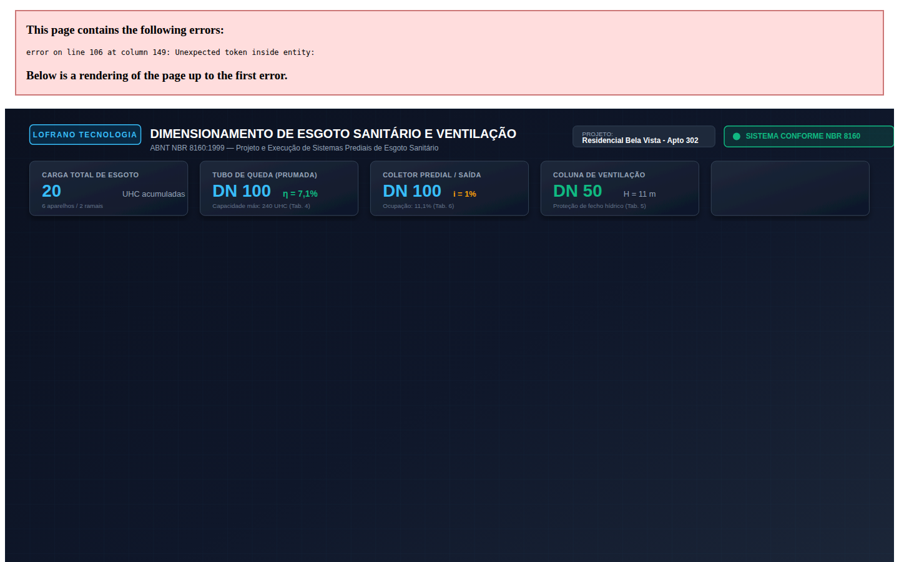

# Dimensionamento de Esgoto Sanitário e Ventilação Predial (ABNT NBR 8160:1999)

[](https://github.com/martinlofranodeoliveira/dimensionamento-esgoto-sanitario-nbr8160/actions/workflows/ci.yml)
[](https://www.python.org/downloads/)
[](LICENSE)
[-emerald.svg)](#garantia-de-zero-float-e-aritmética-exata)
[](#fundamentação-normativa-abnt-nbr-81601999)
[](#filosofia-zero-dependências)

Motor determinístico e biblioteca em Python puro para **dimensionamento, verificação normativa e modelagem físico-sanitária de sistemas prediais de esgoto sanitário e ventilação secundária**, em estrita conformidade com a norma **ABNT NBR 8160:1999** (*Sistemas prediais de esgoto sanitário - Projeto e execução*).

Desenvolvido segundo o padrão de engenharia **LOFRANO TECNOLOGIA**, este pacote utiliza **aritmética racional 100% exata (Zero Float)**, eliminando quaisquer erros de arredondamento de ponto flutuante IEEE-754 no cômputo de Unidades de Hunter de Contribuição (UHC), diâmetros nominais (DN), taxas de ocupação volumétrica e declividades hidráulicas mínimas.

---

## Painel Técnico Vetorial

A biblioteca gera diagramas esquemáticos isométricos e elevações completas do sistema de esgoto e ventilação em formato vetorial SVG de alta resolução (1440x900), com renderização fotográfica disponível:



*(Painel vetorial interativo disponível em [docs/exemplo.svg](docs/exemplo.svg))*

---

## Principais Funcionalidades

1. **Unidades de Hunter de Contribuição (UHC)**:
   - Catálogo normativo completo das Tabelas 1 e 2 da ABNT NBR 8160:1999 para aparelhos de uso residencial, comercial e público.
   - Totalização aditiva exata de UHC por ramal, prumada, subcoletor e coletor predial.

2. **Ramais de Descarga**:
   - Verificação automática de diâmetro nominal mínimo ($DN$) para cada aparelho sanitário individual (ex: bacia sanitária $\ge 100\text{ mm}$, pia residencial $\ge 50\text{ mm}$, lavatório e chuveiro $\ge 40\text{ mm}$).

3. **Ramais de Esgoto Horizontais**:
   - Dimensionamento de diâmetros nominais segundo a Tabela 3 da NBR 8160 ($DN\ 40 \le 3\text{ UHC}$; $DN\ 50 \le 6\text{ UHC}$; $DN\ 75 \le 22\text{ UHC}$; $DN\ 100 \le 160\text{ UHC}$).
   - Verificação mandatória de diâmetro mínimo para ramais que recebem bacias sanitárias ($DN \ge 100\text{ mm}$) e pias de cozinha ($DN \ge 50\text{ mm}$).
   - Validação de declividade mínima de instalação ($2,0\%$ para $DN \le 75\text{ mm}$; $1,0\%$ para $DN \ge 100\text{ mm}$).

4. **Tubos de Queda Verticais (Prumadas)**:
   - Dimensionamento segundo a Tabela 4 da NBR 8160 para edifícios de até 3 pavimentos ou com mais de 3 pavimentos.
   - Cálculo exato da taxa de ocupação hidráulica ($\eta$) e verificação de capacidade limite em UHC.

5. **Ventilação Secundária (Colunas e Ramais de Ventilação)**:
   - Dimensionamento de colunas de ventilação vertical segundo a Tabela 5 da NBR 8160, considerando o diâmetro do tubo de queda e o total de UHC ventiladas.
   - Verificação mandatória de integridade do fecho hídrico ($h \ge 50\text{ mm}$) para caixas sifonadas e sifões individuais.

6. **Subcoletores e Coletor Predial**:
   - Dimensionamento de trechos horizontais enterrados e suspensos segundo a Tabela 6 da NBR 8160 para declividades de $0,5\%$, $1,0\%$, $1,5\%$, $2,0\%$ e $4,0\%$.
   - Imposição do critério de $DN \ge 100\text{ mm}$ e declividade mínima de $1,0\%$ para o coletor predial de saída.

7. **Dispositivos de Retenção e Inspeção**:
   - Dimensionamento de Caixas de Gordura simples ($V \ge 18\text{ L}, D \ge 300\text{ mm}$), duplas ($V \ge 120\text{ L}, D \ge 400\text{ mm}$) e especiais ($V = 2N + 20\text{ L}$).
   - Verificação de Caixas de Inspeção ($600 \times 600\text{ mm}$) e distância máxima permitida de $25,0\text{ metros}$ entre inspeções sucessivas.

---

## Fundamentação Normativa (ABNT NBR 8160:1999)

### 1. Critério de Hunter e Unidades de Contribuição (UHC)

A determinação da carga hidráulica efluente baseia-se no método probabilístico de Roy B. Hunter, onde a probabilidade de uso simultâneo de aparelhos sanitários intermitentes é ponderada em Unidades de Hunter de Contribuição:

$$UHC_{\text{total}} = \sum_{k=1}^{M} N_k \cdot UHC_k$$

Onde:
- $N_k$ é a quantidade do aparelho $k$;
- $UHC_k$ é a contribuição unitária definida nas Tabelas 1 e 2 da NBR 8160.

### 2. Ramais de Esgoto e Declividades Mínimas

Os ramais horizontais devem garantir escoamento com lâmina líquida controlada e autolimpeza para evitar deposição de sólidos suspensos:

| Diâmetro Nominal ($DN$) | Declividade Mínima ($i_{\min}$) | Capacidade Máxima ($UHC$) |
| :---: | :---: | :---: |
| **DN 40** | $2,0\%$ ($0,020\text{ m/m}$) | Até $3\text{ UHC}$ |
| **DN 50** | $2,0\%$ ($0,020\text{ m/m}$) | Até $6\text{ UHC}$ |
| **DN 75** | $2,0\%$ ($0,020\text{ m/m}$) | Até $22\text{ UHC}$ |
| **DN 100** | $1,0\%$ ($0,010\text{ m/m}$) | Até $160\text{ UHC}$ |

*Nota normativa: Qualquer ramal que receba efluente de bacia sanitária deve possuir no mínimo $DN\ 100\text{ mm}$.*

### 3. Tubos de Queda (TQ)

A capacidade de vazão em tubulações verticais limita-se pela espessura da película anular aderida à parede interna do tubo, preservando um núcleo central de ar livre para estabilidade pneumática:

| Diâmetro Nominal ($DN$) | Edifícios até 3 Pavimentos | Edifícios com mais de 3 Pavimentos |
| :---: | :---: | :---: |
| **DN 50** | Até $10\text{ UHC}$ | Até $24\text{ UHC}$ |
| **DN 75** | Até $30\text{ UHC}$ | Até $60\text{ UHC}$ |
| **DN 100** | Até $240\text{ UHC}$ | Até $500\text{ UHC}$ |
| **DN 150** | Até $960\text{ UHC}$ | Até $2.000\text{ UHC}$ |

### 4. Caixas de Gordura (NBR 8160 item 4.2.5.1)

- **Caixa Simples (CS)**: Atende a até 2 cozinhas residenciais com volume de retenção de no mínimo $18\text{ litros}$ e diâmetro interno de $300\text{ mm}$.
- **Caixa Dupla (CD)**: Atende de 3 a 12 cozinhas residenciais com volume de retenção de no mínimo $120\text{ litros}$ e diâmetro interno de $400\text{ mm}$.
- **Caixa Especial**: Para restaurantes ou cozinhas coletivas industriais com $N$ refeições por turno:

$$V_{\text{ret}} = 2 \cdot N + 20 \quad [\text{litros}]$$

---

## Instalação e Requisitos

- **Python**: versão **3.11** ou superior.
- **Dependências de Runtime**: **Zero** (utiliza exclusivamente a biblioteca padrão Python: `fractions`, `dataclasses`, `json`, `csv`, `sqlite3`, `argparse`).

Para instalar localmente em modo editável:

```bash
git clone https://github.com/martinlofranodeoliveira/dimensionamento-esgoto-sanitario-nbr8160.git
cd dimensionamento-esgoto-sanitario-nbr8160
pip install -e .
```

---

## Uso via Linha de Comando (CLI)

O executável de linha de comando `esgoto-sanitario` disponibiliza ferramentas completas de consulta e dimensionamento:

### 1. Consulta a Aparelhos e Tabelas Normativas

```bash
# Lista todos os aparelhos com suas UHC e DN mínimos
esgoto-sanitario aparelhos

# Exibe as tabelas oficiais 3, 4 e 6 da ABNT NBR 8160
esgoto-sanitario tabelas

# Exibe a versão instalada
esgoto-sanitario versao
```

### 2. Dimensionamento Rápido de Componentes Individuais

```bash
# Dimensiona ramal horizontal para 6 UHC com declividade de 2,0%
esgoto-sanitario dimensionar --tipo-trecho ramal --uhc 6 --dn 50 --declividade 2.0

# Dimensiona tubo de queda para 160 UHC em prédio de 8 pavimentos
esgoto-sanitario dimensionar --tipo-trecho tq --uhc 160 --pavimentos 8 --dn 100

# Dimensiona coletor predial para 120 UHC com declividade de 1,0%
esgoto-sanitario dimensionar --tipo-trecho coletor --uhc 120 --dn 100 --declividade 1.0

# Dimensiona coluna de ventilação secundária para 40 UHC
esgoto-sanitario dimensionar --tipo-trecho ventilacao --uhc 40 --dn 50
```

### 3. Dimensionamento Completo de Projeto via JSON

```bash
esgoto-sanitario dimensionar \
  --arquivo examples/apartamento_residencial.json \
  --saida-json resultado.json \
  --saida-csv relatorio.csv \
  --saida-relatorio memorial.txt \
  --painel-svg painel_tecnico.svg
```

---

## Uso via API Python

```python
from fractions import Fraction
from esgoto_sanitario_nbr8160 import (
    AparelhoSanitario,
    RamalDescarga,
    RamalEsgoto,
    TuboQueda,
    ColunaVentilacao,
    ColetorPredial,
    CaixaGordura,
    CaixaInspecao,
    ProjetoEsgoto,
    dimensionar_sistema_esgoto,
    exportar_csv,
    gerar_relatorio_memorial,
    gerar_painel_svg,
)

# 1. Definição dos aparelhos sanitários do banheiro
bacia = AparelhoSanitario("BS-01", "bacia_sanitaria_caixa", 1)  # 6 UHC, DN 100
lavatorio = AparelhoSanitario("LV-01", "lavatorio_residencial", 1)  # 1 UHC, DN 40
chuveiro = AparelhoSanitario("CH-01", "chuveiro_residencial", 1)  # 2 UHC, DN 40

# 2. Ramal de esgoto horizontal do banheiro
ramal_banheiro = RamalEsgoto(
    identificacao="RE-01-BANHEIRO",
    aparelhos=[bacia, lavatorio, chuveiro],
    dn_adotado_mm=100,
    declividade_m_m=Fraction(2, 100),  # 2,0%
    recebe_bacia=True,
)

# 3. Tubo de queda vertical (prumada de 3 pavimentos)
tubo_queda = TuboQueda(
    identificacao="TQ-01",
    ramais_contribuintes=[ramal_banheiro],
    numero_pavimentos=3,
    dn_adotado_mm=100,
)

# 4. Coluna de ventilação secundária
coluna_vent = ColunaVentilacao(
    identificacao="CV-01",
    tubo_queda_associado="TQ-01",
    dn_adotado_mm=50,
    comprimento_m=Fraction(10, 1),
)

# 5. Coletor predial horizontal
coletor = ColetorPredial(
    identificacao="CP-01",
    tubos_queda_contribuintes=["TQ-01"],
    dn_adotado_mm=100,
    declividade_m_m=Fraction(1, 100),  # 1,0%
)

# 6. Consolidação e cálculo do projeto
projeto = ProjetoEsgoto(
    identificacao="Edifício Residencial Exemplo",
    ramais_esgoto=[ramal_banheiro],
    tubos_queda=[tubo_queda],
    coluna_ventilacao=coluna_vent,
    coletor_predial=coletor,
)

resultado = dimensionar_sistema_esgoto(projeto)

print(f"Status Geral: {'APROVADO' if resultado.atende_geral else 'NÃO CONFORME'}")
print(f"Total de Carga: {resultado.total_uhc_geral} UHC")
print(gerar_relatorio_memorial(resultado))
```

---

## Garantias de Engenharia (LOFRANO TECNOLOGIA)

- **Zero Float**: Nenhuma operação aritmética interna utiliza tipos de ponto flutuante binário IEEE-754. Todas as relações físicas, limites normativos e somatórios de carga utilizam frações exatas (`Fraction`) e inteiros.
- **Segurança contra Injeção em CSV**: Todo valor exportado em formato CSV passa pelo sanitizador de fórmulas, adicionando prefixo protetor caso inicie por `=`, `+`, `-`, `@`, `\t` ou `\r`.
- **JSON Canônico**: Validação estrita contra Byte Order Mark (BOM UTF-8), chaves duplicadas e limites de profundidade recursiva ($\le 32$ níveis).
- **Pacote Determinístico**: O arquivo ZIP gerado possui timestamps normalizados para `2026-01-01 00:00:00` e permissões `0o100644`.
- **Auditoria Independente em SQLite**: Inclui o script `tools/verify_independent.py`, que reconstrói os cálculos do zero em banco de dados SQLite em memória sem importar qualquer módulo do pacote de produção.

---

## Licença

Este software é licenciado sob os termos da [Licença MIT](LICENSE). Desenvolvido por Martin Lofrano de Oliveira (LOFRANO TECNOLOGIA).
